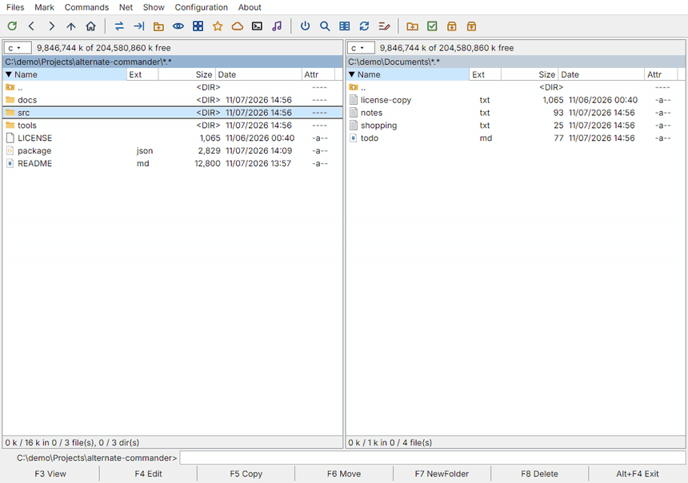
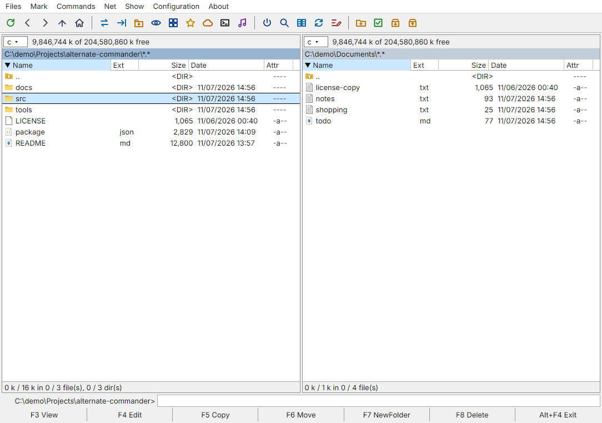
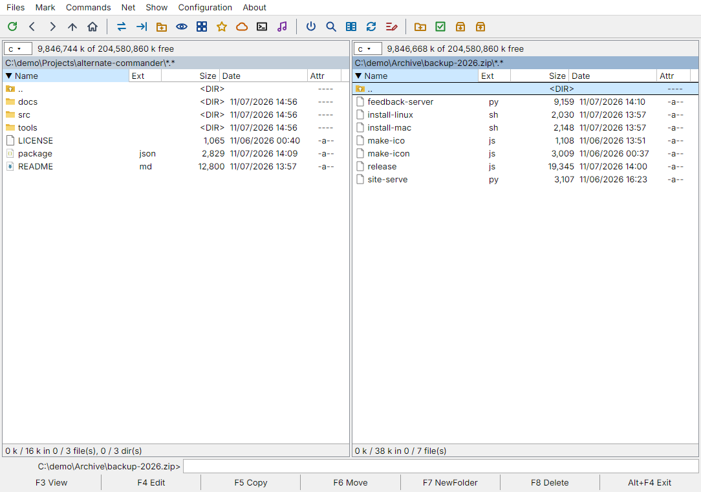
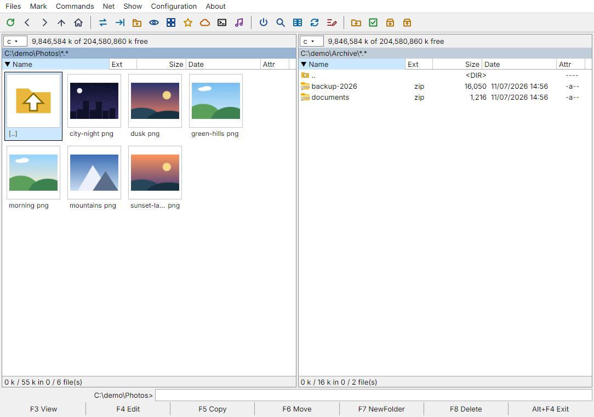
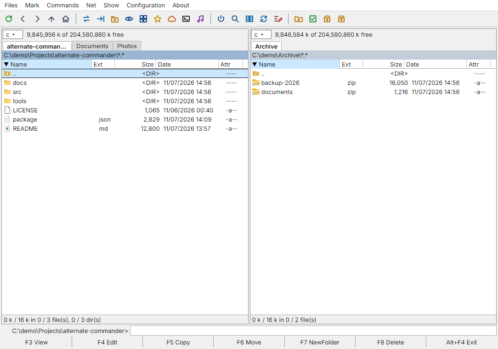
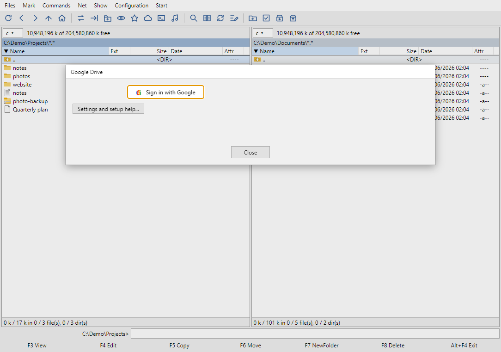

# Alternate Commander

[](LICENSE)
[](https://altcom.cc)
[](https://github.com/powervac/Alternate-Total-Commander/releases/latest)
[](https://altcom.cc)

**A free, open-source two-panel file manager for Windows, macOS and Linux, in the style of Total Commander.**
Keyboard first, archives open like folders, and Google Drive, Dropbox, Synology NAS and SSH servers work as ordinary disks.



> An **unofficial** project: it is **not affiliated with, endorsed by or connected to Total Commander / Ghisler Software**.

## Download

| System | How |
|---|---|
| **Windows 10/11** | [Download the portable exe](https://altcom.cc) (no installation) or take it from the [latest release](https://github.com/powervac/Alternate-Total-Commander/releases/latest), or with Scoop: `scoop bucket add powervac https://github.com/powervac/scoop-bucket` then `scoop install alternate-commander` |
| **macOS** (Apple Silicon and Intel) | In Terminal: `curl -fsSL https://altcom.cc/install-mac.sh \| bash`, or with Homebrew: `brew install --cask powervac/tap/alternate-commander` |
| **Linux** (x86_64, AppImage) | In a terminal: `curl -fsSL https://altcom.cc/install-linux.sh \| bash`, or take the AppImage from the [latest release](https://github.com/powervac/Alternate-Total-Commander/releases/latest) and make it executable |

The program updates itself (Configuration > Check for Updates). The builds are not code-signed yet: on Windows choose *More info > Run anyway* if SmartScreen warns you.
Everything is also on the website: **https://altcom.cc**

## Highlights

- **Two panels and tabs**, a drive list with network drives and favourites, history, quick view, hotlist (Ctrl+D), keyboard shortcuts like Total Commander (F3 view, F4 edit, F5 copy, F6 move, F7 new folder, F8 delete).
- **Archives as folders:** zip, 7z, tar, tar.gz, rar, gz and more open like directories; pack and unpack (zip, 7z, tar, tar.gz...); edit zip files in place.
- **Cloud and servers as disks:** Google Drive, Dropbox, Synology NAS (also through QuickConnect), SSH/SFTP with a real terminal console.
- **Find Files** (Alt+F7) in its own window: masks, regular expressions, text inside files and archives, "Feed to listbox".
- **Viewer and editor:** text with encoding detection, hex, images, PDF, video, audio, Office documents; editor with find/replace.
- **Everyday tools:** compare and synchronize folders, multi-rename, split and combine large files (with .crc like Total Commander), checksums, thumbnails, music player, queue for copy/move jobs.
- **Settings sync** through Dropbox, Google Drive or a folder (connections, favourites, language and view settings).
- **Eight interface languages:** English, Russian, Polish, Portuguese, Spanish, German, Belarusian, Ukrainian.

## Screenshots

| Two panels | Archive opened like a folder |
|---|---|
|  |  |

| Thumbnails | Tabs |
|---|---|
|  |  |



> **Status:** developed on Windows 11; also used on macOS (Intel) and Ubuntu. Bug reports and feature requests are welcome: [open an issue](https://github.com/powervac/Alternate-Total-Commander/issues) or use the form at [altcom.cc](https://altcom.cc/#requests).

*Кратко по-русски:* двухпанельный файловый менеджер в духе Total Commander для Windows, macOS и Linux: архивы как папки (zip, 7z, tar, rar), Google Drive, Dropbox, Synology NAS (QuickConnect), SSH-консоль + SFTP, просмотр (текст, hex, картинки, PDF, видео, аудио, документы Office), редактор, музыкальный плеер, поиск, синхронизация папок, вкладки, групповое переименование. Скачать: https://altcom.cc. Запуск из исходников: `npm install`, затем `npm start` (Windows: `start.bat`, macOS: `./start-mac.command`).

## More features

- **Built-in document viewer** (F3 or Enter): docx, xlsx, pptx, OpenDocument (odt, ods, odp) and the old Word .doc and .rtf (as plain text) are shown by the program itself, with headings, bold/italic, lists, tables and pictures. No Word or Office is needed and it works the same on Windows and macOS. Files > Open With Default Application still opens the system program.

- **Find Files** (Alt+F7), like Total Commander: several masks with exclusions (`*.js;*.ts|node_modules/`), regular expressions, several folders or only the selected items, depth limit, zip names; text search with whole words / case / regex / hex / "not containing", ANSI, DOS, UTF-8 and UTF-16 encodings and text inside docx, xlsx, pptx and OpenDocument files, with the first matching line shown; filters by date, "not older / older than", size and attributes; duplicate finder (same name / size / contents); sortable results; saved searches (Load/Save tab).

- **Thumbnail view** (Ctrl+Shift+F4, Show menu or the toolbar button): the panel shows a grid of pictures - images, video frames, PDFs and documents use the thumbnails of the operating system. Arrow keys move through the grid (up / down jump a whole row). Chosen per panel and remembered.

- **Files menu tools** (like Total Commander): Change Attributes (read-only, hidden, archive, system, date and time, optionally inside subfolders), Properties (Alt+Enter), Calculate Occupied Space (Ctrl+L), Edit Comment (Ctrl+Z, stored in descript.ion), Compare By Content (two files: identical / differences in a side-by-side view, F7 next difference), Test Archive(s) (zip CRC check, Alt+Shift+F9), Split File / Combine Files (name.001, name.002 ...), Encode / Decode File (MIME Base64 and UUE), Create Checksum File(s) (MD5, SHA-1, SHA-256, CRC32) and Verify Checksums. **Multi-Rename Tool** (Ctrl+M) has the Total Commander layout: mask buttons, extension mask, search and replace (1x, [E], RegEx), counter, case, Undo, result list and saved settings.

- **SSH as a disk or a console**: in the SSH connection window "Open as" chooses what opens first, the file list of the server (a disk) or the console. Ctrl+O switches between them at any time.

- **Updates**: the program looks for a newer version a few seconds after start and offers to install it (Configuration > Check for Updates... does it on demand). On Windows the new portable exe and on Linux the new AppImage are downloaded, verified by their SHA-256 and replace the old file; on a Mac the one-line installer runs in Terminal.
- **Space and Insert**: Space selects the file or folder under the cursor and stays on it (a folder also gets the total size of its contents in the Size column); Insert selects and moves one line down.

- **ZX Spectrum emulator**: Enter on a .trd, .scl, .tap, .tzx, .z80, .sna, .szx, .fdi, .td0, .udi, .csw or .hob file starts it in the built-in emulator (Unreal Speccy Portable compiled to WebAssembly). Also Files > Run in ZX Spectrum Emulator.
- **Interface languages**: English, Russian, Polish, Portuguese, Spanish, German, Belarusian, Ukrainian (Configuration > Language...). Menus, dialogs, buttons and tooltips are translated; file names and some error messages with variable text stay as they are.
- **WSL as a disk**: the installed Linux distributions and their home folders appear in the drive list (Alt+F1 / Alt+F2) as WSL: <name>; any \wsl$<name>... path works like a normal folder.
- **Favourites on remote disks**: Ctrl+D also adds the current folder of Dropbox, Google Drive, NAS and SSH; choosing it reconnects (if needed) and goes straight there.
- **One font everywhere**: the interface uses the bundled Inter font, so text looks the same on Windows and macOS.

- **Settings in Dropbox** (Configuration > Settings in Dropbox...): connections (without passwords), favourites, search and rename presets, language and view settings are kept in /Commander/settings.json in your Dropbox and merged on every computer (the newer change of each setting wins; synced at start and after changes). Passwords, logins and the SSH key files of your connections can be kept there too, encrypted on your computer with a passphrase (AES-256-GCM, PBKDF2) so that Dropbox only holds an unreadable block; without the option they stay on each computer. The Dropbox login itself is never synced: sign in to Dropbox once per computer.
- **Import from WinSCP** (Net > Import from WinSCP...): the SSH/SFTP/SCP sessions of WinSCP (registry or WinSCP.ini) become SSH connections; their key files are copied into the program's protected key folder (and travel with the encrypted Dropbox settings); passwords are not imported. PuTTY keys of version 2 (RSA/DSA) and OpenSSH/PEM keys work directly; version 3 or ed25519 .ppk files must first be exported to OpenSSH format with PuTTYgen.

## Features

- **Two panels**, tabs per panel, history, drive list with network drives and standard folders (Alt+F1 / Alt+F2), directory hotlist, quick view panel, toolbar.
- **File operations** with progress and cancel: copy, move, rename, new folder, delete (to the Recycle Bin / Trash), multi-rename tool, compare and synchronize folders, search (names, text in files, names inside zip).
- **Archives:** pack and unpack zip; open a zip like a folder and edit it in place (add, delete, rename, new folder). A zip on a NAS / SSH server opens as a read-only folder (it is downloaded to a temporary copy; files can be copied out of it).
- **Synology NAS** (File Station API, works through **QuickConnect**): browse, copy both ways, create, rename, delete, view/edit, stream video and music.
- **Dropbox and Google Drive** as remote disks (Net menu > Dropbox... / Google Drive..., also in the Alt+F1 / Alt+F2 list): browse, copy both ways, create, rename, delete, view/edit, stream video and music. They use the official APIs with OAuth sign-in in your browser, so **no desktop client is needed**. You create your own free API app once (see "Cloud drives" below).
- **SSH servers** (password or key file): the panel shows an interactive **console** (xterm.js); files copied (F5) or dropped into the console are uploaded to the console's current folder. Ctrl+O switches to an SFTP file list.
- **Viewer (F3):** text with automatic encoding detection (UTF-8/16, Windows-1251, CP866...), hex, images, PDF, video and audio. Formats Chromium cannot play (HEVC, AVI, WMV, AC3 sound, APE, WavPack, ALAC, AIFF...) are converted on the fly by a bundled **ffmpeg**.
- **Editor (F4):** keeps encoding, BOM and line endings; find/replace; works on files inside zip archives and on a NAS / SSH server.
- **Music player:** Enter on an audio file plays the folder in the background (mp3, FLAC, WAV, OGG, AAC; lossless formats through ffmpeg), media keys supported.

## Run

Requirements: [Node.js](https://nodejs.org) 18 or newer.

```bash
npm install
npm start
```

- Windows: double-click `start.bat`.
- macOS: `./start-mac.command` (run `chmod +x start-mac.command` once) or `npm start`.

## Build installers

```bash
npm run pack        # unpacked app in dist/ (quick check)
npm run dist:win    # Windows installer (run on Windows)
npm run dist:mac    # .dmg + .zip for Apple Silicon and Intel (run on a Mac)
```

macOS builds must be made on a Mac. The app is not signed or notarized: if macOS says it is damaged or from an unidentified developer, right-click > Open, or run `xattr -cr /Applications/Commander.app`.
The first time the app reads Documents, Downloads or Desktop, macOS asks for permission.

## Keyboard (Windows | macOS)

`Ctrl` becomes `Cmd` and `Alt` becomes `Option` on macOS, except where noted.

| Keys | Action |
|---|---|
| Tab | switch panel |
| Enter / Backspace | open / go up |
| Space, Insert | select and move down |
| Num +, Num -, Num *, Ctrl+A | select group, unselect group, invert, select all |
| F3 / F4 / Shift+F4 | view / edit / edit new file |
| F5 / F6 / Shift+F6 | copy / move / rename |
| F7 / F8 (Shift+F8) | new folder / delete (permanently) |
| Alt+F1 / Alt+F2 | drive list of the left / right panel |
| Alt+F5 / Alt+F9 | pack / unpack |
| Alt+F7 | find files |
| Shift+F2 | compare folders |
| Ctrl+R / Ctrl+U | reread / swap panels |
| Ctrl+T, Ctrl+W, Ctrl+Tab, Ctrl+Up | new tab, close tab, next tab, open folder in new tab |
| Ctrl+Q (Ctrl on macOS too) | quick view panel |
| Ctrl+D | directory hotlist |
| Ctrl+M | multi-rename |
| Ctrl+F / Ctrl+Shift+F | Synology NAS / SSH server connections |
| Ctrl+O | SSH panel: console <-> file list |
| Ctrl+Space (macOS: Option+Space), Ctrl+Shift+Left/Right | music player: play/pause, previous/next track |

**macOS notes:** the F-keys need `Fn` (or enable "Use F1, F2, etc. keys as standard function keys" in System Settings > Keyboard); the buttons at the bottom of the window and the menus do the same. Mac keyboards have no Insert or numeric keypad: use Space and the Mark menu.

## Cloud drives (Dropbox, Google Drive)

Dropbox and Google require every program to identify itself with its own API key. Builds that contain the key (file `src/main/oauth-defaults.json`, format: `{"google":{"clientId":"...","clientSecret":"..."},"dropbox":{"appKey":"..."}}`) show just one button: *Sign in with Google* / *Sign in with Dropbox*. Without it, create your own key once (free); the window shows the steps. The key is remembered for all accounts.

**Dropbox:** [App Console](https://www.dropbox.com/developers/apps) > Create app > Scoped access > Full Dropbox. Permissions: `files.metadata.read`, `files.metadata.write`, `files.content.read`, `files.content.write` > Submit. Copy the **App key** into Net > Dropbox..., add the Redirect URI `http://127.0.0.1:53682` (Settings tab), press *Sign in with Dropbox* and approve in the browser.

**Google Drive:** [Cloud Console](https://console.cloud.google.com/apis/credentials): create a project, enable the *Google Drive API*, configure the OAuth consent screen (External; add yourself as a test user, or press *Publish app* so the login does not expire after 7 days), then Credentials > OAuth client ID > *Desktop app*. Copy the **Client ID** and **Client secret** into Net > Google Drive... and press *Connect*; the browser opens and you approve.

Notes: only a refresh token is stored (encrypted with the system keychain, optional "Stay signed in"); your files never pass through any server except Dropbox / Google. Google documents (Docs, Sheets, Slides) appear with an extra `.docx` / `.xlsx` / `.pptx` and are exported when copied. Deleting in Dropbox goes to its deleted files, in Google Drive to the Trash.

## Security notes

- Saved passwords are optional and encrypted with the operating system (Windows DPAPI / macOS Keychain, Electron `safeStorage`). Nothing is sent anywhere except to the server you connect to.
- SSH uses trust-on-first-use host keys (stored in the app data folder); a changed key is reported.
- The local streaming proxy used for NAS media listens only on `127.0.0.1` and requires a random per-run token.

## Third-party software

[Electron](https://www.electronjs.org), [ssh2](https://github.com/mscdex/ssh2), [xterm.js](https://xtermjs.org), [yauzl](https://github.com/thejoshwolfe/yauzl) / [yazl](https://github.com/thejoshwolfe/yazl), and [ffmpeg-static](https://github.com/eugeneware/ffmpeg-static) (downloads an FFmpeg build at install time; FFmpeg is LGPL/GPL, see its license). No FFmpeg binary is stored in this repository.

## License

MIT, see [LICENSE](LICENSE).

## Third-party components

- **Unreal Speccy Portable** (GPL-3.0, https://github.com/djdron/UnrealSpeccyP) compiled to WebAssembly in src/renderer/emu/ (license and source note there). It runs in its own window as a separate component. The workflow .github/workflows/build-emulator.yml rebuilds it.
- **Inter** font (SIL Open Font License 1.1) in src/renderer/fonts/.
